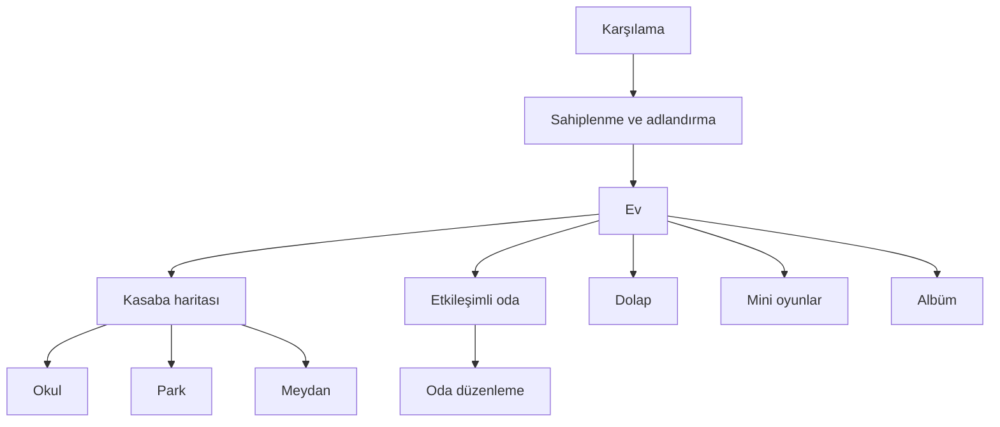

# Mimari

## Model ve katalog

- `PKPet`: tür, ad, kişilik, altı ihtiyaç, büyüme puanı, beceriler, arkadaşlıklar, meslek ve türe bağlı favori/sevilmeyen mama eşlemesi.
- `PKGameState`: para, gün, eylem sayısı, kaynak yolu, envanter, oda, sahip olunan/takılan aksesuarlar, görev, anı, koleksiyon, ses ve günlük ödül kuralları.
- `PKCatalog`: sekiz eşya, sekiz aksesuar, beş beceri, dört komşu, 12 konumlu görev ve beş meslek için küçük, değişmez katalog.
- Kayıt: `NSUserDefaults` içinde yalnızca property-list uyumlu sözlük/dizi/değerler. `saveVersion=3`; 0.1/0.2 alanları eksikse güvenli varsayılanlar ve iki başlangıç aksesuarı kullanılır.

## Görsel ve ses bileşenleri

- `PKPetAvatarView`: dört türü, üç büyüme ölçeğini, dört aksesuar katmanını, kuyruğu ve kısa tepki sembollerini Core Graphics ile çizer. Baş/karın/pati/kuyruk bölgelerini tek geometri hesabıyla döndürür. Ortak `visualScale=0.25` çizimi küçültür; görünür yavrudan daha büyük erişilebilir dokunma alanı korunur.
- `PKRoomBackgroundView`: gün/mevsim renklerini ve sabit yuvalardaki mobilyaları çizer; aynı yuvalar için hafif dokunma testi yapar. Mama kabı gövde, üst kenar, mama ve pati işaretinden; hayvan yatağı dış çeper, iç minder, yükseltilmiş ön kenar ve pati motifinden oluşur. Sürükleme sırasında hedef eşyayı tek sarı halka ile vurgular.
- `PKTownMapView`: dört bölge arasındaki yol ve nehri Core Graphics ile çizer; ayrı sahneleri önbelleğe almaz.
- `PKAmbientObjectView`: haritadaki bayrak, ağaç ve feneri bir kez Core Graphics ile çizer; hareket sırasında yalnızca görünüm katmanının dönüşümü/şeffaflığı değişir.
- `PKActivitySceneView`: Park, Okul ve Meydan arka planlarını bitmap yüklemeden Core Graphics şekilleriyle çizer. Etkileşimli kartlar ve yavru ayrı UIKit görünümleridir; sahne dokunma almaz.
- `PKActionPropView`: normal mama, balık, havuç veya kurabiye içeren mama kabını; topu ve fırçayı tek küçük Core Graphics görünümünde çizer. Aynı görünüm sürükleme hedefi, top yuvarlanması ve mamanın boşalması durumlarını yeniden çizerek gösterir; bitmap kare dizisi tutmaz.
- `PKThoughtBubbleView`: ihtiyaç veya tepki simgesiyle en fazla bir kısa cümleyi Core Graphics balonu içinde gösterir; uzun sonuç metni arayüzün ana taşıyıcısı değildir.
- `PKNeedBarView`, `PKPetCardControl`, `PKTheme`: ihtiyaç, seçim ve ortak stil.
- `PKSoundManager`: dokunma/başarı ile altı eylem sesinden oluşan sekiz küçük mono WAV dosyasını `AudioServicesPlaySystemSound` ile istek üzerine yükleyip oynatır.
- `PKVoiceRepeatManager`: en fazla üç saniyelik mikrofon sesini geçici bir IMA4 CAF dosyasına kaydeder ve doğrudan aynı cihazda oynatır. Dosya hesap, kalıcı oyun kaydı veya ağ katmanına girmez.

## Ekran akışı

Ev ekranı merkezdir. Alt ekranlar aynı `PKGameState` örneğini kullanır; görünüm kaybolurken kayıt alınır ve eve dönünce arayüz yenilenir. Görev tamamlaması okul, park veya meydan denetleyicisinde konum kimliğiyle doğrulanır.

Evde dokunma bölgeleri yalnızca kısa görsel/işitsel tepki üretir ve ekonomi sayacını ilerletmez. Bakım tamamlanınca beş mikro tepkiden biri tek sefer çalışabilir. Mama seçimi `PKPet` tercih eşlemesinden geçerek `PKGameState` içindeki tokluk/duygu sonucunu belirler. Ses tekrar açıkça başlatılan üç saniyelik bir akıştır ve ekran kapanınca iptal edilir.

Haritadaki küçük yavru `UIPanGestureRecognizer` ile bölge düğmelerine bırakılabilir. Aynı etkileşim modeli evde bakım düğmelerine, odada mobilyalara, okulda ders/meslek kartlarına, parkta komşulara ve meydanda etkinlik/görev hedeflerine uygulanır. Evde ayrıca mama, top ve fırça doğrudan yavrunun üzerine sürüklenebilir. Geçerli bırakmada eylem çalışır, geçersiz bırakmada yavru veya nesne başlangıç noktasına döner. Büyük kartlara ve bakım nesnelerine dokunmak motor becerisi veya sürükleme güçlüğü yaşayan çocuklar için eşdeğer alternatif olarak kalır.

## Zaman ve simülasyon

- Sürekli oyun saati yoktur.
- Anlamlı bakım, ders, ziyaret, etkinlik, çalışma veya ödüllü mini oyun turu bir eylem ilerletir.
- Her dört eylem bir günü ilerletir ve 20 pati harçlığı verir.
- Günün bölümü eylem sayısından, mevsim gün sayısından türetilir.
- Kişiliğe bağlı özgür irade olayı her üçüncü başarılı eylemde üretilir; oda veya ev ekranında kısa bir hedef yolculuğu ve düşünce balonuyla gösterilir. Arka plan yapay zekâsı yoktur.
- `Top Yakala` sekiz gecikmiş, sonlu turdan oluşur; ekran kapanınca bütün bekleyen turlar iptal edilir. Sürekli oyun döngüsü yoktur.
- “Sürekli simülasyon” hissi bir arka plan oyun döngüsünden değil; oyuncu eylemi → nesne/yavru yolculuğu → kısa tepki → ihtiyaç/ilişki değişimi → gerektiğinde özerk an → boşta hareket zincirinden oluşur.

## Bellek stratejisi

- Açık dünya veya sahne önbelleği yok; navigasyon denetleyicisi yalnızca mevcut yolun ekranlarını tutar.
- Büyük doku atlası yok; ana görseller vektör şekillerinden oluşur.
- Kasaba görünümünde en fazla dört hayvan vardır.
- Tepki ve hedefe yolculuk animasyonları kısa `UIView` geçişleridir. Besleme, top, fırça, uyku ve sevgi dizileri sırayla çalışan birkaç transform/alpha değişiminden oluşur. Ortam ve boşta bekleme hareketleri en fazla birkaç küçük görünümün transform/alpha değerini değiştirir; ekran kaybolunca `removeAllAnimations` ile durur. `NSTimer`, `CADisplayLink`, GIF kare dizisi, SVG yorumlayıcı veya doku atlası yoktur.
- Fotoğraflar 512×352 JPEG olarak saklanır, albüm 12 kayıtla sınırlanır ve artık başvurulmayan JPEG'ler silinir.
- Sesler mono 22.05 kHz ve toplamda küçüktür.

## MRC kuralları

- Uzun ömürlü ivar'lar `retain` veya `copy` ile sahiplenilir ve `dealloc` içinde bırakılır.
- View/delegate ilişkilerinde döngü kurulmaz.
- Blok tabanlı uzun ömürlü API kullanılmaz.
- Gecikmiş çağrılar ekran kapanırken iptal edilir.
