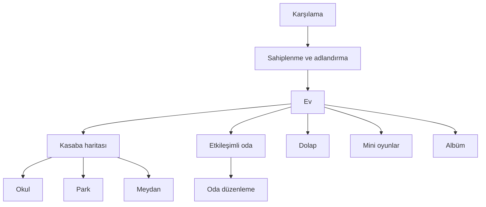

# Mimari

## Model ve katalog

- `PKPet`: tür, ad, kişilik, altı ihtiyaç, büyüme puanı, beceriler, arkadaşlıklar ve meslek.
- `PKGameState`: para, gün, eylem sayısı, kaynak yolu, envanter, oda, sahip olunan/takılan aksesuarlar, görev, anı, koleksiyon, ses ve günlük ödül kuralları.
- `PKCatalog`: sekiz eşya, sekiz aksesuar, beş beceri, dört komşu, 12 konumlu görev ve beş meslek için küçük, değişmez katalog.
- Kayıt: `NSUserDefaults` içinde yalnızca property-list uyumlu sözlük/dizi/değerler. `saveVersion=3`; 0.1/0.2 alanları eksikse güvenli varsayılanlar ve iki başlangıç aksesuarı kullanılır.

## Görsel ve ses bileşenleri

- `PKPetAvatarView`: dört türü, üç büyüme ölçeğini, dört aksesuar katmanını ve kısa tepki sembollerini Core Graphics ile çizer.
- `PKRoomBackgroundView`: gün/mevsim renklerini ve sabit yuvalardaki mobilyaları çizer; aynı yuvalar için hafif dokunma testi yapar.
- `PKTownMapView`: dört bölge arasındaki yol ve nehri Core Graphics ile çizer; ayrı sahneleri önbelleğe almaz.
- `PKNeedBarView`, `PKPetCardControl`, `PKTheme`: ihtiyaç, seçim ve ortak stil.
- `PKSoundManager`: iki küçük mono WAV dosyasını `AudioServicesPlaySystemSound` ile istek üzerine oynatır.

## Ekran akışı

Ev ekranı merkezdir. Alt ekranlar aynı `PKGameState` örneğini kullanır; görünüm kaybolurken kayıt alınır ve eve dönünce arayüz yenilenir. Görev tamamlaması okul, park veya meydan denetleyicisinde konum kimliğiyle doğrulanır.

## Zaman ve simülasyon

- Sürekli oyun saati yoktur.
- Anlamlı bakım, ders, ziyaret, etkinlik, çalışma veya ödüllü mini oyun turu bir eylem ilerletir.
- Her dört eylem bir günü ilerletir ve 20 pati harçlığı verir.
- Günün bölümü eylem sayısından, mevsim gün sayısından türetilir.
- Kişiliğe bağlı özgür irade metni her üçüncü eylemde olay olarak üretilir; arka plan yapay zekâsı yoktur.

## Bellek stratejisi

- Açık dünya veya sahne önbelleği yok; navigasyon denetleyicisi yalnızca mevcut yolun ekranlarını tutar.
- Büyük doku atlası yok; ana görseller vektör şekillerinden oluşur.
- Kasaba görünümünde en fazla dört hayvan vardır.
- Animasyonlar kısa `UIView` geçişleridir; `NSTimer`/`CADisplayLink` yoktur.
- Fotoğraflar 512×352 JPEG olarak saklanır, albüm 12 kayıtla sınırlanır ve artık başvurulmayan JPEG'ler silinir.
- Sesler mono 22.05 kHz ve toplamda küçüktür.

## MRC kuralları

- Uzun ömürlü ivar'lar `retain` veya `copy` ile sahiplenilir ve `dealloc` içinde bırakılır.
- View/delegate ilişkilerinde döngü kurulmaz.
- Blok tabanlı uzun ömürlü API kullanılmaz.
- Gecikmiş çağrılar ekran kapanırken iptal edilir.
